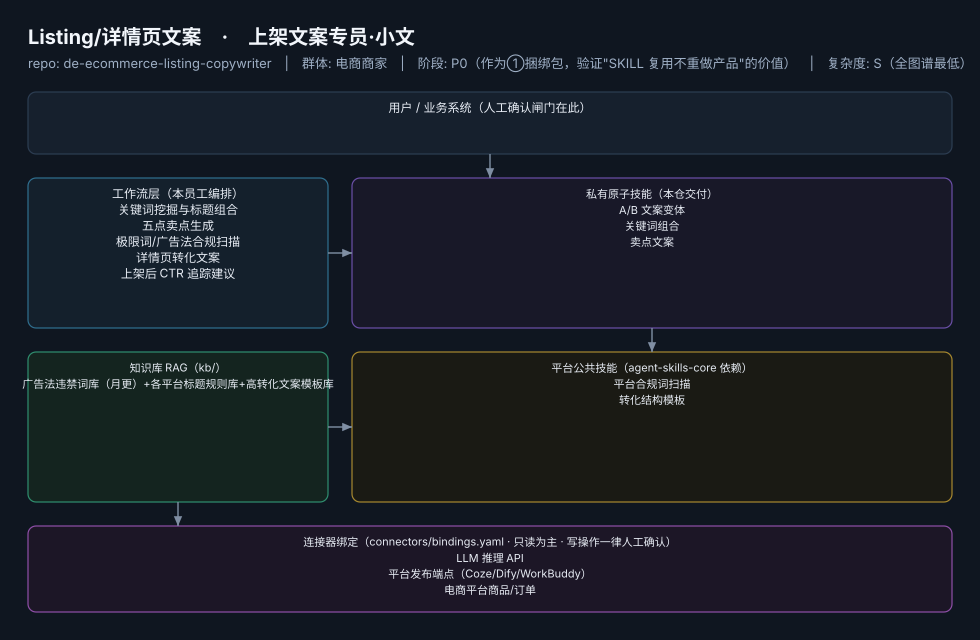
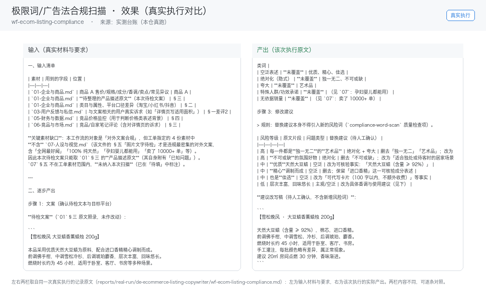

# Listing/详情页文案

> 上架文案专员·小文 ｜ ①视觉员工的配套另一半——图和文案是同一次上架的两半
>
> **上架文案专员·小文**　·　电商商家　·　阶段 P0（作为①捆绑包，验证"SKILL 复用不重做产品"的价值）　·　
> 复杂度 S（全图谱最低）　·　30-80 元/月（单独卖偏弱，建议与①捆绑）　·　定义卡 6.4-⑦

## 演示（真实执行录播）


*真实执行回放（GIF 自动循环，非摆拍）· [▶ 观看完整版 MP4](workflows/wf-ecom-listing-compliance/docs/images/08-demo-run.mp4) · 台账见 [`reports/real-run/wf-ecom-listing-compliance.md`](reports/real-run/wf-ecom-listing-compliance.md)*



## 效果（真实执行）



*上图为**真实效果对比**，不是示意图：左栏是输入材料与要求，右栏是该次执行的产出原文，
两栏取自同一次真实执行记录。*

- 完整台账：[`reports/real-run/wf-ecom-listing-compliance.md`](reports/real-run/wf-ecom-listing-compliance.md)
- 录屏与终端回放：[`workflows/wf-ecom-listing-compliance/docs/images/`](workflows/wf-ecom-listing-compliance/docs/images/)（`08-demo-run.gif` / `08-demo-run.mp4` / `04-terminal-run.png`）
- 使用示例：[`workflows/wf-ecom-listing-compliance/docs/使用示例.md`](workflows/wf-ecom-listing-compliance/docs/使用示例.md)
> 实测判定：**通过**　·　可用度 3/5　·　编造数字 0 处　·　红线命中 1 次 / 拦截 1 次


**一句话**：月上新频繁、标题 SEO 靠抄的一人店

---

## 这个数字员工解决什么问题

上架文案专员·小文 ｜ ①视觉员工的配套另一半——图和文案是同一次上架的两半

| 项 | 内容 |
|---|---|
| 服务对象 | 月上新频繁、标题 SEO 靠抄的一人店 |
| 可量化目标 | 标题生成→上架 ≤10 分钟；合规扫描覆盖率 100%；CTR 环比提升 |
| 投入产出 | 月省文案工时 15h≈¥450 |
| 需求依据 | D01、D26 |
| 分发渠道 | GitHub、Coze扣子商店、淘宝（"标题优化工具+词库"¥19.9-49.9，虚拟老店类目已验证） |

## 30 秒上手

```bash
git clone <本仓库地址> && cd de-ecommerce-listing-copywriter
pip install pyyaml
python3 tests/run.py            # 先跑一遍自检，确认环境与契约都对得上
```

试用（把 `<输入>` 换成本人真实材料）：

```text
请以「Listing/详情页文案」的身份，帮我跑「关键词挖掘与标题组合」。
材料如下：<输入>
要求：只使用材料里出现过的数字，缺的写 <待填>；对外文案停在待确认状态。
```

详细接入见 [`docs/01-安装与接入.md`](docs/01-安装与接入.md)。

## 仓库结构

```text
de-ecommerce-listing-copywriter/
├── employee.md            # 人读定义卡（12 主字段 + 2 扩展组，由 employee.yaml 生成）
├── employee.yaml          # 机器契约（能力清单 + 依赖锁）
├── dependencies.yaml      # 对 core 的外部依赖（含版本）
├── persona/               # 运行提示词 / 边界 / KPI
├── skills/                # 私有原子技能（3 个）
├── spec-bindings/         # 有意不公共化能力的本地绑定声明（0 个）
├── workflows/             # 本员工工作流（5 条）
├── kb/                    # 知识库 RAG 契约
├── connectors/            # 连接器绑定（只读为主，写操作人工确认）
├── docs/                  # 六类发布文档
└── tests/                 # 自动化多场景测试
```

## 私有原子技能（3）

| 技能 | slug | 复杂度 | 阶段 | 成熟度 |
|---|---|---|---|---|
| `A/B 文案变体` | `ab-copy-variants` | S | P2 | 契约完备 |
| `关键词组合` | `keyword-combiner` | S | P0 | 契约完备 |
| `卖点文案` | `sellingpoint-copy` | S | P0 | 契约完备 |

## 平台公共技能依赖（2）

| 技能 | slug | 全平台复用员工数 |
|---|---|---|
| `平台合规词扫描` | `compliance-word-scan` | 6 |
| `转化结构模板` | `conversion-structure-template` | 2 |

> 这些技能来自 `agent-skills-core@1.0.0`，本仓库**只引用不复制**。

## Spec 绑定层（0）

（无）

> 这一族能力**有意不公共化**（与外部平台接口强绑定）。本仓不存正文，
> 只留本地绑定声明与连接器配置。

## 工作流（5）

| 工作流 | slug | 触发 | 阶段 | 调用技能数 |
|---|---|---|---|---|
| `关键词挖掘与标题组合` | `wf-ecom-listing-title` | 人工 | P0（随①捆绑） | 1 |
| `五点卖点生成` | `wf-ecom-listing-sellingpoint` | 人工 | P0 | 1 |
| `极限词/广告法合规扫描` | `wf-ecom-listing-compliance` | 事件（文案定稿） | P0 | 1 |
| `详情页转化文案` | `wf-ecom-listing-detail-copy` | 人工 | P1 | 1 |
| `上架后 CTR 追踪建议` | `wf-ecom-listing-ctr-tracking` | 定时（每周） | P2 | 1 |

## 知识库与连接器

- 知识库语料：['广告法违禁词库（月更）+各平台标题规则库+高转化文案模板库']
- 连接器：LLM 推理 API、平台发布端点（Coze/Dify/WorkBuddy）、电商平台商品/订单

## 质量与验收

| 项 | 值 |
|---|---|
| 技能文件数 | 155 |
| 多场景用例数 | 222 |
| 用例通过 | 222 |
| 验收结论 | ✅ 通过 |

完整报告：[`docs/05-验收与测试.md`](docs/05-验收与测试.md)

## 许可

专有许可，详见 [`LICENSE`](LICENSE)。
